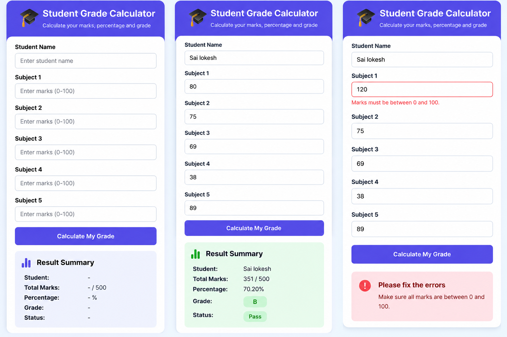

🎓 Student Grade Calculator

A responsive web application built to calculate student marks, percentages, grades, and pass/fail status.

🌐 Live Demo

Launch Student Grade Calculator

✨ Features

* Enter a student’s name.
* Enter marks for five subjects.
* Calculate total marks out of 500.
* Calculate percentage automatically.
* Display grades and pass/fail status.
* Validate marks between 0 and 100.
* Responsive design for mobile devices.

🛠️ Technologies Used

* HTML5
* CSS3
* JavaScript
* GitHub
* GitHub Pages

🚀 How to Use

1. Open the live website.
2. Enter the student’s name.
3. Enter marks for all five subjects.
4. Tap Calculate My Grade.
5. View the total, percentage, grade, and result.

📁 Project Structure

* index.html — website structure, styling, and functionality
* README.md — project documentation
👨‍💻 Author

Sai Lokesh Mechineni

GitHub: @sailokesh121

## 📸 Project Screenshot

